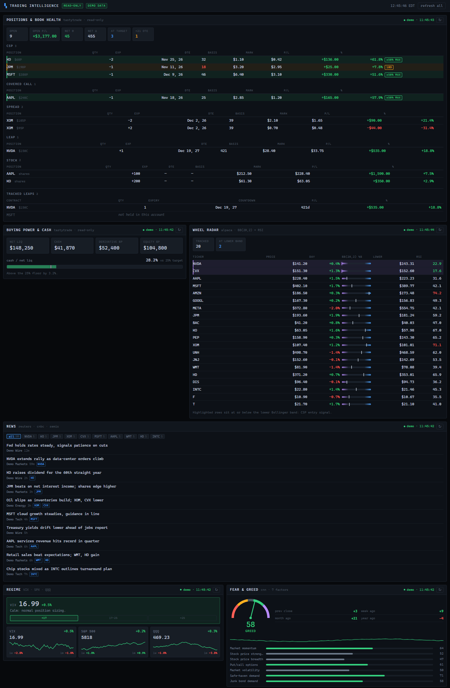
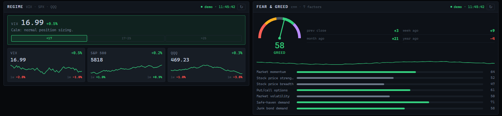
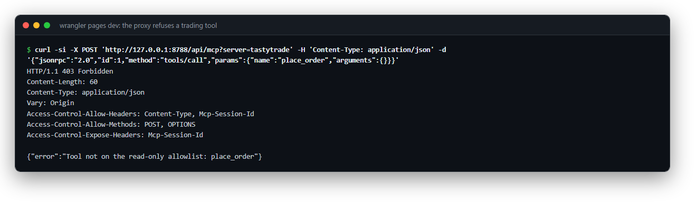
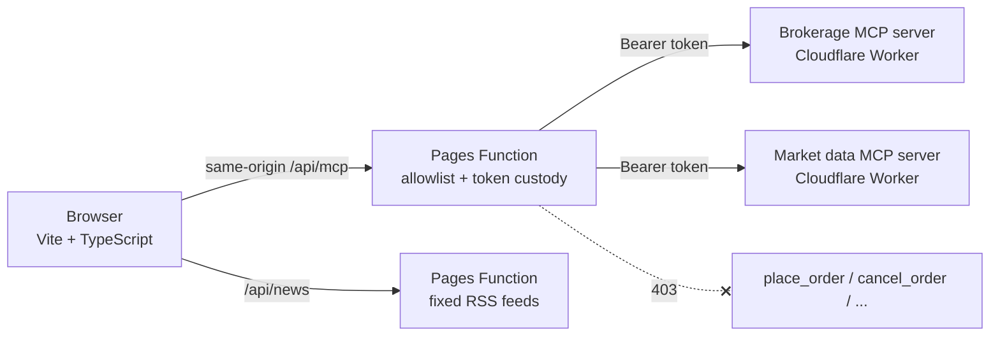

# trading-dashboard

**A read-only view of an options book, sitting on top of servers that can trade, built so the dashboard itself can never place an order.**

I built this with my 11-year-old son as a weekend learning project. Not investment advice.

> **A word from my co-developer.** Built by an 11-year-old, with parent supervision. He'd like everyone to know his custodial account beat QQQ and the S&P 500 this year, and he's right, it did. Gotta start 'em early. (And no, he's not available for hire. He has homework. I'm joking!) Not investment advice; past results don't predict anything.


*Demo mode. Every position, balance, price and headline is synthetic, and each panel's badge says "demo".*

## The problem

Our brokerage account is wired to Claude through MCP servers. Claude can read positions, run screens and, with an operator switch turned on and a per-order confirmation in the chat, place orders. What I still wanted was one dense screen of the book: P/L by strategy, what's near profit target or expiry, cash against target, and the market regime.

The catch is that a dashboard bolted onto a server that can trade is a second door into the account, and usually a weaker one. So I treated it the way an auditor would. The read-only guarantee lives on the server side, in a proxy with an allowlist. Nothing in the browser code is trusted to keep it read-only.

## What it does

- **Positions and book health.** Joins cost basis with live marks, labels each leg (CSP, covered call, vertical spread, LEAP, stock) and flags anything at 50% or more of max profit or inside 21 DTE.
- **Buying power and cash.** Net liq, cash and buying power, with a bar showing cash against a target share of net liq.
- **Wheel radar.** Bollinger %B and RSI across a watchlist. Names at the lower band float to the top as put-selling candidates.
- **Regime.** A VIX band (calm, elevated, stressed) next to SPX and QQQ sparklines.
- **Fear & Greed.** The CNN index and its seven components.
- **News.** An RSS aggregator with ticker filter chips.

Every panel paints its last good data straight away and marks it stale if a source is down, so the screen is never blank.


*Regime and Fear & Greed in demo mode: VIX band with SPX/QQQ sparklines, and the index with its seven components. All values synthetic.*

## Controls

| Control | How it's enforced |
|---|---|
| **Read-only by allowlist** | Every MCP call goes through [`functions/api/mcp.ts`](functions/api/mcp.ts). Allowed tools are listed by hand. Anything else gets a `403`, including `place_order`, `place_spread`, `cancel_order` and the watchlist writers. |
| **No pattern-matching on names** | The allowlist is deliberately not `/^get_/`. A naming rule is one renamed tool away from letting a write through. |
| **No batch smuggling** | Batched JSON-RPC is rejected, so a blocked call can't ride along next to an allowed one. |
| **Credentials stay server-side** | Bearer tokens and upstream URLs are Cloudflare secrets, read by the Pages Function at request time. Nothing is prefixed `VITE_`, because Vite inlines those into the public bundle. |
| **Missing config fails closed** | If an upstream URL or the brokerage token is missing, the proxy returns `500` and forwards nothing. |
| **Blocked attempts are logged** | Every rejected tool call is logged by the proxy and shows up in `wrangler pages deployment tail`. |
| **Fixed outbound URLs** | The news function only fetches a fixed, server-side list of feeds, so it can't be used as an open proxy. |
| **Untrusted links stay inert** | Headlines come from third-party feeds. Only `http(s)://` links are made clickable, so a `javascript:` link in a feed renders as plain text. |

You can check the allowlist yourself against a running dev server:

```powershell
curl.exe -s -X POST "http://127.0.0.1:8788/api/mcp?server=tastytrade" `
  -H "Content-Type: application/json" `
  -d '{\"jsonrpc\":\"2.0\",\"id\":1,\"method\":\"tools/call\",\"params\":{\"name\":\"place_order\",\"arguments\":{}}}'
# {"error":"Tool not on the read-only allowlist: place_order"}
```

<details>
<summary>macOS / Linux</summary>

```bash
curl -s -X POST 'http://127.0.0.1:8788/api/mcp?server=tastytrade' \
  -H 'Content-Type: application/json' \
  -d '{"jsonrpc":"2.0","id":1,"method":"tools/call","params":{"name":"place_order","arguments":{}}}'
```

</details>


*Same check against `wrangler pages dev`. `place_order` gets a 403 from the proxy and never reaches the brokerage server.*

## Architecture



## Quickstart

Demo mode, no account needed. Needs Node 22+.

```powershell
git clone https://github.com/markvalderrama001-svg/trading-dashboard.git
cd trading-dashboard
npm install
npm test
npm run demo          # open http://localhost:5173
```

<details>
<summary>macOS / Linux</summary>

```bash
git clone https://github.com/markvalderrama001-svg/trading-dashboard.git && cd trading-dashboard
npm install && npm test
npm run demo
```

</details>

Demo mode feeds synthetic positions, balances, technicals and headlines from [`src/lib/demo.ts`](src/lib/demo.ts) through the same parsing, P/L and strategy code the live mode uses. Adding `?demo` to any deployed URL does the same thing. `npm run build:demo` writes a static build to `dist-demo/` that you can host anywhere, GitHub Pages included.

## Running against your own MCP servers

```powershell
copy .dev.vars.example .dev.vars  # fill in URLs and tokens; .dev.vars is gitignored
npm run build
npx wrangler pages dev dist --port 8788
```

<details>
<summary>macOS / Linux</summary>

```bash
cp .dev.vars.example .dev.vars
npm run build
npx wrangler pages dev dist --port 8788
```

</details>

| Variable | Purpose |
|---|---|
| `TASTYTRADE_MCP_URL` | Streamable HTTP endpoint of your brokerage MCP server. Required. |
| `TASTYTRADE_MCP_TOKEN` | Bearer token for it. Required. |
| `ALPACA_MCP_URL` / `ALPACA_MCP_TOKEN` | Market data MCP server and its token. |
| `ALLOWED_ORIGIN` | Optional. Only needed to permit a cross-origin caller. |

Deploying to Cloudflare Pages:

```powershell
npm run build
npx wrangler pages deploy dist --project-name trading-dashboard
npx wrangler pages secret put TASTYTRADE_MCP_TOKEN --project-name trading-dashboard
# ...repeat for the other variables
```

The dashboard has no login of its own. Put [Cloudflare Access](https://developers.cloudflare.com/cloudflare-one/policies/access/) in front of it. Nobody can trade from it, but positions and balances are still private.

## Notes on the data

- **P/L takes two calls.** `get_positions` has cost basis but no mark. `get_position_greeks` has the mark but no cost basis. They're joined on the OCC symbol, and share marks come from the market-data server's `get_snapshot`.
- **Strategy labels are inferred**, because the API returns flat legs. Verticals are paired nearest strike first, using up quantity as they go. Without that, a book holding a 275/250 put spread plus a separate naked 330 put at the same expiry would call all three legs a spread. A covered call needs at least 100 shares per contract in the same underlying.
- **Regime uses the brokerage feed.** The equity data API doesn't serve VIX or SPX.

## Configuration

Everything you'd want to tune is in [`src/config.ts`](src/config.ts): the watchlist, tracked LEAPs, the profit target (50%), the DTE warning (21), the cash target (25%), the VIX bands and the refresh intervals.

## Project structure

```
functions/api/mcp.ts      MCP proxy: token custody + read-only allowlist
functions/api/news.ts     RSS aggregation, parsing, dedupe
src/lib/mcp.ts            JSON-RPC 2.0 / Streamable HTTP client
src/lib/demo.ts           Synthetic data for demo mode
src/lib/positions.ts      OCC symbol parsing, P/L, strategy classification
src/lib/panel.ts          Panel shell: cache-first render, status, refresh
src/lib/cache.ts          localStorage last-good cache
src/lib/fmt.ts            Formatting, HTML escaping, safe-link check
src/panels/*.ts           One module per panel
src/config.ts             All user-tunable settings
tests/                    vitest: positions and strategy labels, link check
docs/                     README screenshots
index.html                Page shell
package.json              Scripts, deps, engines (Node 22+)
vite.config.ts            Dev server proxy for /api, build target
tsconfig.json
.dev.vars.example         Placeholder URLs and tokens for wrangler pages dev
```

Independent project. Not affiliated with or endorsed by Tastytrade, Alpaca, CNN, Reuters or CNBC; names are used only to describe what the code connects to.

---

**About.** Mark Valderrama, CPA · Finance Engineer. Built with my son; see above. [LinkedIn](https://www.linkedin.com/in/markvalderrama/)

MIT License, see [LICENSE](LICENSE).
